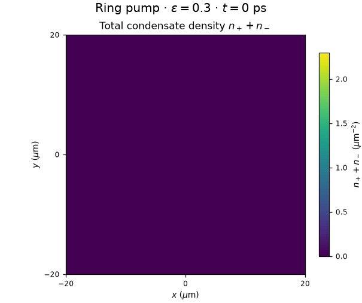

# Polariton Condensate: Spin and Reservoir Dynamics

Numerical study of driven polariton condensates with active/inactive reservoirs, circular polarizations, internal Josephson coupling and momentum-dependent TE–TM coupling. This is a separate continuation of [polariton-condensate-dynamics](https://github.com/kontvak/polariton-condensate-dynamics). Comparisons are recalculated here; the earlier report is cited by title.

[Experiment results](docs/results_overview.md) · [Methods](docs/methods.md) · [Measured checks](docs/diagnostic_summary.md)

[English report](latex/report_en.pdf) · [Russian report](latex/report.pdf)



## Start

Python 3.11 or newer:

```bash
python3 -m venv .venv
source .venv/bin/activate
pip install -r requirements.txt
jupyter lab polariton_spin.ipynb
```

The notebook runs a short homogeneous example and opens saved figures. Long calculations are disabled by default. Numerical NPZ archives are retained locally and excluded from Git; they are required to redraw the completed figures. The repository includes rendered figures and numerical JSON summaries. The new spatial spin series exports its own portable archive when complete.

```bash
# Redraw the simplified main figures from saved data; no integration.
MPLBACKEND=Agg python -c 'from plotting import make_report_figures; make_report_figures()'

# Optional compact physical checks.
python -m pytest -q
```

## TE–TM study (report 3)

The completed baseline includes 14 spatial cases, four TE–TM coefficient variants and a new 15-point homogeneous J scan. Five spot states pass full-map periodicity and cycle-centre checks. Matched ring preparations and C1 convergence controls are tracked separately; unfinished scientific classifications remain explicit. See the dated [results overview](docs/results_overview.md) and [numerical audit](results/data/report3/report_readiness.json). The earlier report PDFs are unchanged.

Calculations on this machine use Intel Arc, PyTorch XPU and compiler dependencies from `../profiling`. The numerical method is exact Fourier kinetic/TE–TM propagation with compiled joint local RK4 and Strang splitting. Long production runs use complex128/float64; complex64 is used only where separately checked. There is no temperature or wall-time cutoff.

Local queue control (start and resume launch a background worker):

```bash
bash local/run_report3_queue.sh status
bash local/run_report3_queue.sh eta     # measured remaining-time range
bash local/run_report3_queue.sh check   # validate parameters/checkpoints; no integration
bash local/run_report3_queue.sh start --note "Start the next batch"
bash local/run_report3_queue.sh pause   # save state and stop; alias: stop
bash local/run_report3_queue.sh resume --note "Continue saved calculations"
```

To add an experiment without launching it, for example:

```bash
bash local/run_report3_queue.sh add spot_J005 --source production_J1_spot \
  --until 3000 --set physical.J=0.005 --priority 10 --note "J scan: Gaussian spot"
bash local/run_report3_queue.sh note spot_J005 "Inspect relative phase"
bash local/run_report3_queue.sh extend spot_J005 --until 6000
```

The machine-local plan is `local/experiments.yaml`. Lower priority numbers run first; dependencies use `--after ID`. `disable ID` and `enable ID` change scheduling without deleting results. `pause --after-current` finishes the active experiment before stopping. Launch comments are retained in attempt history and experiment notes in the plan/log. ETA uses measured comparable runs and reports unknown when a suitable timing is unavailable; it is not a deadline.

The plan is reread between experiments; an existing physical run cannot silently change parameters. Completed cases are reused, interrupted cases resume, and missing exports are rebuilt from saved fields without integration. Checkpoints and exports are replaced atomically. Pause skips expensive analysis after saving the physical state; resume completes that analysis. Each experiment has its own log. Failed checks stop the queue; execution completion and scientific acceptance are distinct. Queue source, launch scripts, the experiment plan and the current figure plan are versioned; launch logs and raw checkpoints remain ignored by Git.

Portable arrays, configurations and measured diagnostics are in `results/data/report3/`; exact checkpoints and full-field probes are in `results/runs/report3/`. Both circular densities are retained every 20 ps for animations, while full complex fields are sampled every 5 ps in the retained analysis interval. The matched ring series retains them throughout the trajectory. Final figures use PNG only; report PDFs are built separately.

## Figures for the five-chapter TE–TM report

CPU rendering is available through `plotting.make_report3_figures()`; use `animations=False` to redraw only PNGs. The current set contains 10 main PNGs, one diagnostic PNG and six 30-second GIFs in [results/figures/report3](results/figures/report3/). Captions, source configurations, physical frame times, field hashes and scientific statuses are in [figure_manifest.json](results/data/report3/figure_manifest.json). PNGs are 160 mm wide at 300 dpi; no figure PDFs are produced. GIFs start at 0 ps and use actual saved density or complex-field frames without temporal interpolation. They are not added to the report PDFs.

C1 spot Stokes uses the completed half-time-step control with full complex history. T0 ring density and Stokes animations extend to 6000 ps: the latter exposes slow polarization evolution hidden by stationary densities. F8 uses common polar quadrature of the complex fields, avoiding unequal Cartesian sector sampling; coupling labels state the physical terms rather than only run codes.

Chapter 1 is ready. Chapter 2 has density maps with a separate diagnostic for the unresolved small cross-spin effect. Chapter 3 includes established spot results and explicitly evolving T0 ring polarization. Chapter 4 compares the sampled spatial cases; it does not claim a completed 2D J scan. A0/A1/T1 ring periodicity passed an independent full-map audit. Chapter 5 includes completed C1 spatial/time-step controls, Stokes maps and animations. The current queue is complete; no further integrations were started by rendering.

## Models and methods

- **M0:** scalar condensate and one active reservoir, preserving the earlier model.
- **M1:** scalar condensate and a matched active/inactive reservoir cascade; R1 and R2 have different response times.
- **M2:** two circular components and reservoir spin flip, without coherent coupling.
- **M3:** the same spinor model with a real local coupling `−J`.

Homogeneous series use DOP853. Spatial calculations use Fourier Strang splitting and a joint local RK4 step, in double precision. Independent analytic limits, RK4 comparisons, particle balance and ring grid/time refinements are checked. Units are µm, ps and meV.

The matched scalar models retain the same stationary solutions. Their turn-on trajectories select opposite vortex circulation for the prescribed seed; a separate stationary-state control preserves the old vortex. The 105-point spinor scan includes running-phase cycles, bounded-phase cycles and phase-locked steady states. State continuations near the polarization reversal demonstrate coexisting attractors. These are results for the stated parameters and initial conditions, not a complete phase diagram.

## Files

| Path | Purpose |
|---|---|
| `polariton_spin.ipynb` | Main interface: example, calculations, figures and optional checks |
| `model.py` | Equations, physical parameters, pumps, continuous seed and analytic branches |
| `numerics.py` | Integrators, observables, classification, checkpoints and research series |
| `plotting.py` | Simplified N1–N6 PNGs and supplementary F/D figures from saved arrays |
| `config.yaml` | Common coefficients, F1–F5 scenarios and the spatial spin N3 profile |
| `test_project.py` | One compact set of physical/numerical checks; no CI workflow |
| `results/` | Portable arrays, numerical summaries and PNG figures |
| `docs/` | Experiment results, calculation methods and measured checks |

`results/data/report_data.npz` contains 0D histories for all scan points and additional phases, plus final fields/history for the five ring runs. The full time resolution is retained in the current analysis windows and their amplitude-lag comparisons and in the demonstration trajectories; other F5 history uses exact saved frames at 20 ps spacing. Complete local trajectories remain in `results/runs/`. `reference_checks.npz` contains independent reference residuals. F5 includes 105 J values with dense ranges near the phase changes and polarization reversal. Late-time refinement, state continuations and tighter-tolerance checks are exposed in the notebook. JSON files record analysis windows, errors and statuses. Arrays use no pickle.

Detailed full-field snapshots and resumable checkpoints stay in ignored `results/runs/`; they are generated by calculations rather than copied from the old repository. The notebook exposes explicit switches for recomputation. `run_0d_series(force=True)` replaces cached 0D cases; `run_spin_refinement()` resolves the dense J ranges and extends slow cases, reusing cached states; `run_polarization_controls()` checks attractor selection at the reversal; `run_ring_suite()` resumes ring checkpoints and performs the required refinements and conditional stationary-state control. There is no hard wall-time cutoff. The measured ring runs took approximately 10–71 minutes each on the current machine; the full series takes longer.

## Figures for the next report

The main set N1–N6 answers three questions: how an inactive reservoir changes pump-switching transients, how polarized pumping redistributes circular populations, and how coherent coupling changes density oscillations and relative phase. N3 adds spatial maps at two pump polarizations. The other five simplified figures reuse completed calculations. English captions, methods and measured checks are collected in `docs/`; both report languages are available in `latex/`.

Static figures are exported as PNG files, 160 mm wide at 300 dpi, with 8–10 pt labels for A4 placement. Main figures are in `results/figures/report/`; the original F1–F5 and diagnostic D1–D3 remain supplementary. D4 adds individual populations and masked local polarization for the new spatial series. Both report PDFs are available in `latex/`.

The main GIF shows the total density n₊+n₋ at pump polarization 0.3: all 116 saved maps from 0 to 2300 ps, sampled every 20 ps, form an exact 10-second loop. The viridis color scale and palette stay fixed throughout, with physical time shown on each frame and no additional endpoint pauses. The cropped maps and source hash are stored in `results/data/N3_eps_03_total_animation.npz` and its JSON manifest. Rebuild without `results/runs/`:

```bash
MPLBACKEND=Agg .venv/bin/python -c 'from plotting import make_total_density_gif; print(make_total_density_gif(duration_s=10))'
```

The [two-component GIF](results/figures/report/N3_eps_03_evolution.gif) remains available separately. It shows the densities side by side using six saved snapshots at 0, 200, 500, 1000, 2000 and 2300 ps, with a common fixed density scale and endpoint pauses. Its physical time intervals are unequal. The cropped densities and source hashes are stored in `results/data/N3_eps_03_animation.npz` and its JSON manifest:

```bash
MPLBACKEND=Agg .venv/bin/python -c 'from plotting import make_spatial_spin_gif; print(make_spatial_spin_gif())'
```

Neither GIF interpolates or integrates intermediate fields. Use `refresh=True` with either function to refresh its archive from local saved maps after a new calculation.

## Spatial spin calculations

```bash
# Four independent runs in parallel; resume their saved checkpoints.
.venv/bin/python -u -c 'from numerics import run_spatial_spin_suite; from plotting import make_report_figures; r=run_spatial_spin_suite(max_workers=4); print(r["assessment"]); make_report_figures()'
```

The series uses pump polarizations 0 and 0.3, a 512² grid, 256 µm domain and 0.025 ps time step, plus independent 256² and 0.0125 ps checks for polarization 0.3. All runs use the same continuous seed split equally between components and initially empty reservoirs. Each component and its reservoirs are checked separately in two consecutive 100 ps windows. Runs start with a 2000 ps final time and extend together in 100 ps increments, up to 4000 ps if required. One hour is a runtime guide; no hard wall-time cutoff discards a calculation.

All four N3 runs are complete at 2300 ps and pass stationarity and convergence checks. At pump polarization 0.3, the main run gives N₊=440.2656, N₋=169.6108 and Z=0.44379; the population-normalized density profiles differ by 5.55% in relative L2 norm. The largest population difference in the independent grid/time-step checks is 0.00176%.

`results/data/N3_summary.json` records completed cases and measured checks. `results/data/spatial_spin.npz` contains final fields, reservoirs, histories and resolved configurations after completion. Detailed checkpoints stay in ignored `results/runs/`. Use fewer worker processes if needed; do not start a second copy of the same suite while one is already running.

## Report

The reports are available in [English](latex/report_en.pdf) and [Russian](latex/report.pdf), with sources [`latex/report_en.tex`](latex/report_en.tex) and [`latex/report.tex`](latex/report.tex). Both follow the previous reports: A4, 12 pt, three sections and two appendices. The English version translates the current Russian report, using terminology checked against the cited articles, including active/inactive exciton reservoirs, circularly polarized components, reservoir spin relaxation and internal Josephson coupling. Both versions include the completed N3 maps, measured populations and convergence checks. Redrawing the saved data updates the reserved result blocks in both language versions and rebuilds both PDFs if `latexmk` is installed. No time integration is performed by the plotting command.

```bash
cd latex
latexmk -pdf report.tex
latexmk -pdf report_en.tex
```
