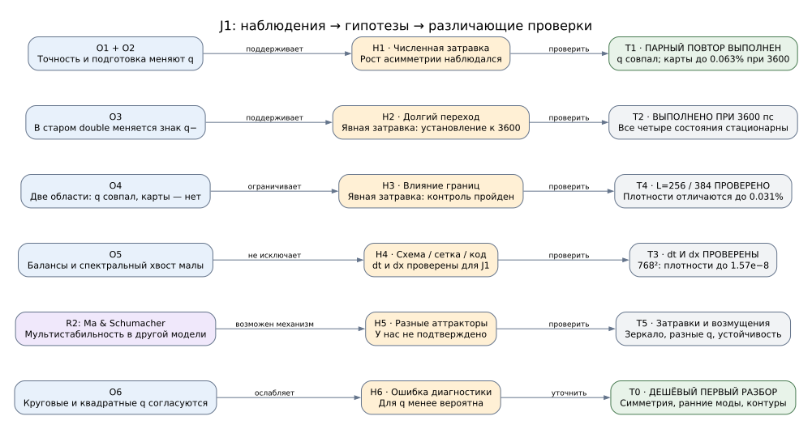
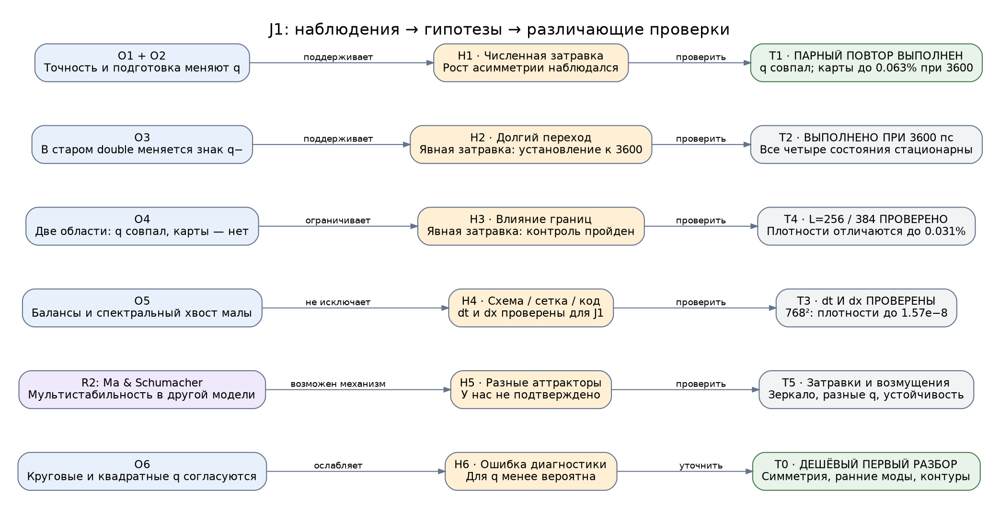

# Граф знаний: почему в J1 получаются разные вихревые заряды

Состояние знаний: 26 октября 2026 г. Объект — **J1 новой спиновой серии**, кольцо, `p=3.3`, `epsilon=0.3`, `J=0.010 meV`, `beta=0`, резервуары R1. Основной метод — Strang/FFT с совместным локальным RK4. К старому скалярному отчёту эти выводы автоматически не относятся.

**Цель:** для каждого прогона установить, пригоден ли он для заявленного вывода; отделить ошибку реализации/дискретизации, усиление округлений, незавершённый переход и зависимость физического исхода от подготовки. Сравнение двух точностей само по себе не определяет, какая из них ближе к решению уравнений. Статьи подтверждают возможность механизмов, но не устанавливают правильный заряд для наших параметров.

**Текущий итог:** четыре расчёта с одной явной затравкой — complex64/128, половинный dt и большая область — при 3600 пс стационарны на двух последовательных окнах и дают q+=q−=−3. В конечной плотности разница точностей ≤0.063%, временных шагов ≤0.0013%, областей ≤0.031%. Ранние радиальные повторы показывают усиление численного нарушения зеркальной симметрии. Главная проблема отбора моды и преждевременного сравнения прояснена; независимый старт 768² при L=256 также прошёл: q±=−3, максимальная поздняя разность плотностей 1.57e−8. Дальнейшие широкие проверки затравок не нужны для ограниченного вывода о данной подготовке. Это результат одной заданной подготовки, не универсальный заряд.

**Обновление проверки dx:** [численные ошибки](../results/data/report3/report_readiness.json) → `J1_grid`; оба режима стационарны при 3600 пс. Старые формулировки плана ниже сохраняют историю гипотез. Для отчёта дополнительные ансамбли q не назначаются.

## Одинаковая подготовка всей кольцевой серии

Согласованная новая серия B0/A0/A1/T0/T1/C1 поставлена после прежних очередей, готовый J1 используется повторно. Два ожидающих β-кольца также получают ту же явную модуляцию. Совпадение начальных массивов с J1 проверено точно. Начальная цель 3600 пс, при необходимости одно общее продолжение до 6000 пс; исходные радиальные результаты сохраняются отдельно. [Очередь](../results/data/report3/report3_matched_ring_queue.json), [подробная постановка и проверка анализатора](results_overview.md#сопоставимая-кольцевая-серия-и-проверка-предельного-цикла).

Проверка периодики усилена: помимо периода/амплитуды и повторения полных карт в двух окнах сравниваются средние карты за целое число циклов. Медленный дрейф центра оставляет UNRESOLVED. На синтетическом примере это устранило ложное принятие приближающегося режима за цикл. Это конечновременной критерий; полный тест притяжения после возмущения состояния не заявляется.

## Какие заряды получали в литературе

Указанные ниже значения относятся к разным моделям и параметрам; это примеры существования состояний, а не список допустимых зарядов нашего J1. Для каждой ненулевой на замкнутом контуре комплексной компоненты q — целое число; существование и устойчивость конкретной ветви требуют отдельных проверок.

| Статья | Какие значения получены | Условия и ограничения |
|---|---|---|
| Ma & Schumacher, PRL 121, 227404 (2018), [DOI](https://doi.org/10.1103/PhysRevLett.121.227404) | q=±1, ±2, ±3 | Теория: все шесть вихрей устойчивы при одних параметрах кольцевой некогерентной накачки; явная мультистабильность. Один резервуар, не наш спинор с J. |
| Alperin & Berloff, Optica 8, 301–307 (2021), [DOI](https://doi.org/10.1364/OPTICA.418377), [открытый текст](https://api.repository.cam.ac.uk/server/api/core/bitstreams/470c70eb-4e5d-4f11-964b-4e1c438720f7/content) | На рис. 3 два вихря q=2 сливаются в q=4; на рис. 2 приведены профили q=1,3,5,7,9 | Теория кольцевой накачки. Пример q=4: r0=15 мкм, P=10; профили высоких зарядов: r0=20 мкм, P=12. Напротив, при радиусе 7 мкм и P=10 добавление четвёртого кванта в примере рис. 6 вызывает распад. Значит, число 4 само по себе не является ни ошибкой, ни гарантией устойчивости. P — их нормировка. |
| Jheng, Chen & Cheng, Optics Express 30, 35325–35337 (2022), [DOI](https://doi.org/10.1364/OE.468330), [полный текст](https://opg.optica.org/oe/fulltext.cfm?uri=oe-30-20-35325) | Центральные заряды 3 и 8; также описаны устойчивые гигантские вихри с зарядом по модулю >20 | Теория: кольцевая накачка плюс внешняя гармоническая ловушка. Часть примеров содержит также другие вихри вне центрального ядра. Геометрия существенно отличается от нашей. |
| Ma et al., Nature Communications 11, 897 (2020), [статья](https://www.nature.com/articles/s41467-020-14702-5) | q=+1 и −1, оптическое переключение знака | Эксперимент и моделирование при кольцевой некогерентной накачке. Здесь есть подтверждение в эксперименте; высокие заряды в предыдущих строках — теоретические результаты. |

**Для нашего вывода:** литература не выделяет q=−3 как единственный правильный и не запрещает q=−4. Она показывает зависимость от геометрии, накачки и подготовки и допускает сосуществование нескольких устойчивых зарядов. Устойчивость именно −4 при наших параметрах не установлена. Сейчас подтверждён −3 для одной явно заданной подготовки; общий перечень её аттракторов мы не вычисляли. q=0 также топологически допустим, но из этого не следует устойчивость безвихревого режима в данной накачке. Дробные средние углового момента или среднего заряда по ансамблю не следует путать с целочисленным фазовым обходом одной компоненты.

## Итог кольцевых проверок при 3600 пс

[Полная обработка завершённых кольцевых данных](../results/data/report3/charge_ring_final_review.json). Обработка выполнена отдельно от работающей spot-очереди; новых физических прогонов при анализе не запускали. Прежние разделы ниже сохраняют историю проверок, а этот раздел задаёт актуальный вывод.

**Четыре подтверждённых поздних состояния:** L=256/N=512/dt=0.025 в complex128 и complex64; L=256/N=512/dt=0.0125 в complex128; L=384/N=768/dt=0.025 в complex128. Везде dx=0.5 мкм, t=3600 пс, та же модуляция 1e-3 и `perturb_seed=20261025`. Все четыре — STATIONARY на окнах [3200,3400] и [3400,3600] пс. Проверены N±, оба активных/неактивных резервуара, обе плотности, три карты Стокса и спинор после исключения одной общей фазы. Все имеют q+=q−=−3 и Lz/(ħN)≈−3; заряд независимо подтверждён на пяти квадратных контурах с достаточной плотностью, в дополнение к круговым. Фазовая диагностика проведена в complex128/float64 и для сохранённого complex64-поля; само решение от этого не менялось.

| Контроль относительно L=256/N=512/dt=0.025 complex128 | Разность N+/N− при 3600 пс | L2-разность плотности +/− при 3600 пс |
|---|---:|---:|
| complex64 | 0.00572% / 0.05556% | 0.01353% / 0.06220% |
| dt=0.0125 | 0.001290% / 0.001282% | 0.001191% / 0.001200% |
| L=384, общая центральная область | 0.00602% / 0.01801% | 0.01187% / 0.03094% |

Разности относятся к наблюдаемым, не являются строгой верхней оценкой ошибки относительно точного решения. Порядок схемы по двум шагам отдельно не установлен. Временной контроль и контроль области проходят выбранные допуски для этой подготовки. Краевые доли поздних контролей около 2.99e-7 и 1.50e-10; балансы проходят, для complex64 их остаток около 1e-5, для complex128 порядка 1e-12…1e-11.

**Оговорка для complex64:** конечная карта при 3600 пс проходит арифметические ориентиры <0.1% по N/плотности и <0.001 по RMS нормированных Стоксов. Но на всём интервале 3200–3600 пс максимальная разность N− — 0.151%, плотности n− на выборке — 0.178%, RMS одного Стокса — 0.00113. Строгое утверждение о точности <0.1% для всей поздней траектории пока не выполнено. Для рисунка конечного состояния результат достаточен в этих допусках; это не общее разрешение заменять все расчёты на complex64.

### Что показали ранние радиальные повторы

Два новых старта до 800 пс восстановили доступные населённости исходных радиальных прогонов в контрольных временах 200/400/600/800 пс без различия. Это подтверждает воспроизводимость этих скаляров, но не побитовое совпадение старых ранних полей, которые не сохранились. В исходной радиальной подготовке random seed не создаёт шум.

[Ранние моды complex128](../results/data/report3/charge_J1_radial_early_c128_early_modes.json), [complex64](../results/data/report3/charge_J1_radial_early_c64_early_modes.json). Обе подготовки зеркально-симметричны при t=0. Относительный дефект отражения поля:

| t, пс | complex128 | complex64 |
|---:|---:|---:|
| 100 | 3.62e-14 | 8.20e-5 |
| 400 | 6.43e-12 | 1.27e-2 |
| 600 | 1.05e-9 | 3.48e-1 |
| 800 | 4.78e-8 | 1.45 |

Таким образом, численно внесённые асимметрии в single успевают стать макроскопическими намного раньше. На r=8 мкм при 800 пс в double веса m=+4 и −4 почти равны: у компоненты «+» около 0.475/0.475. Это угловая модуляция без выбранного направления циркуляции. В single у той же компоненты веса +4/−4 около 0.873/0.051: возник сильный направленный дисбаланс. Значение промежуточного q в single при 800 пс не является конечным зарядом. Сам вес m=4 не доказывает артефакт сетки: проекция на окружность использует интерполяцию, а физическая неустойчивость и дискретизация могут действовать вместе. Нужен отдельный контроль dx для такого вывода.

**Какой вывод был ошибочным:** выбирать между −3 и −4 как между «верным single» и «верным double», считать радиальный старт явно заданной физической шумовой подготовкой и принимать переходный кадр за конечное состояние. Ошибки знака, единиц или общей формулы GPU-шага короткими проверками не обнаружены. Причина различия старых исходов поддерживается наблюдаемым усилением численных возмущений; отдельная операция, создающая решающее возмущение (FFT/локальная арифметика/дискретизация), не локализована. Для практического протокола это уже не требует новой большой серии: явно задаём подготовку и проверяем конечные наблюдаемые.

### Остался ли необходимый запуск

**Для разбора старого расхождения и устранения его из протокола — дополнительный длинный запуск не нужен.** Имеются одинаковый q, установление, контроль dtype, dt и L для явно заданного старта. Продлевать старые радиальные состояния ради выбора победителя не приоритетно; ансамбль многих seed сейчас не нужен, если не заявлять универсальность/вероятности зарядов.

**Для полной численной приёмки нового J1 остаётся один отдельный вопрос — dx.** Все четыре контроля имеют dx=0.5; изменение N вместе с L его не проверяет. Скалярная сходимость прежнего отчёта также не закрывает спинор с J. Минимум по числу новых запусков: один независимый старт с той же непрерывной модуляцией, L=256, N=768 (dx=1/3), dt=0.025, complex128, до 3600 пс. Оценка по уже измеренной сетке 768² — **90–120 минут**. Сравнить две стационарные компоненты/резервуары, N±, карты Стокса, q и Lz на общем позднем интервале; допуски прежние. Если финальный вывод о q/профиле меняется или состояние не установилось, этот один контроль не считается пройденным; сначала выяснить причину, не запускать сеточную серию автоматически. Более дешёвый N=256 за 10–20 минут проверит чувствительность к огрублению, но при его провале всё равно потребуется более мелкая сетка; поэтому для минимального количества запусков предпочтительнее сразу N=768.

Этот запуск **поставлен после ранее согласованных spot-контролей**: режим `local/run_charge_checks.py --ring-grid`, [статус](../results/data/report3/charge_grid_queue.json), [журнал](../local/charge_grid.log). Отдельный ожидающий процесс использует общий GPU-lock. Новый старт от t=0: N=768, L=256, dt=0.025, complex128, до 3600 пс. Проверено точное совпадение непрерывной затравки в общих узлах; для карт применяется периодическая Fourier-проекция на сетку эталона, отдельно сохраняются исходные населённости и потеря нормы при проекции. Полные комплексные поля сохраняются через 5 пс по всей траектории. Оценка 90–120 минут после начала; новых продолжений автоматически не назначает. В дальнейшем сохранять ранние комплексные поля, фиксировать амплитуду/спектр/seed явной затравки, проверять две компоненты и резервуары на двух поздних окнах, отдельно принимать арифметику, dt, dx и границы. Совпадение заряда и малый баланс не заменяют остальных проверок.

## Карта связей

[Открыть граф крупно](vortex_charge_knowledge_graph.svg).

Синий — наши наблюдения; фиолетовый — результат статьи для другой модели; оранжевый — гипотеза; серый — проверка. «Поддерживает» не означает «доказывает». Вторичные связи перечислены в таблице гипотез; исходник рисунка находится в конце файла.

## Проверенные наблюдения

| Узел | Факт | Данные / ограничение |
|---|---|---|
| **O1** | Исходная радиальная подготовка: при 3000 пс complex128 даёт `(q+,q−)=(-4,-4)`, complex64 — `(-3,-3)`. | [precision_review.json](../results/data/report3/precision_review.json). В `kind=radial` случайного шума нет; поле `seed` не используется. Отличия округлений не являются заданной физической моделью шума. |
| **O2** | С фиксированной вещественной модуляцией (`epsilon_seed=1e-3`, `perturb_seed=20261025`) complex128 даёт `(-3,-3)` уже при 2000 пс в обеих областях. | [boundary_queue.json](../results/data/report3/boundary_queue.json). На общих узлах начальные поля совпадают точно. Позже парный complex64 выполнен: q совпал при 2000 и 3000 пс; см. обновление очереди ниже. |
| **O3** | Старый complex128: при 2000 пс `(-4,+4)`, при 2500 и 3000 пс `(-4,-4)`. | [История зарядов](../results/data/report3/boundary_review.json), `controlled_domain_analysis`. Сам знак второй компоненты ещё менялся. |
| **O4** | Для заданной модуляции увеличение L=256→384 мкм сохраняет q=-3, но при 2000 пс различия центральных плотностей — 4.63%/14.16%; поздние населённости колеблются. | Там же. dx=0.5 мкм одинаков: **это контроль области, не разрешения**. Размер FFT и его округления также изменились. |
| **O5** | Поздний краевой вес контролей ≤3.04e-7 / 1.59e-10; балансы <1.4e-11; высокочастотный вес <6.2e-12. | Малые числа не ограничивают усиление малых возмущений и не доказывают точность выбора q. Короткие поздние проверки уже пропустили сильное расхождение длинных траекторий. |
| **O6** | Заряды подтверждаются несколькими круговыми и независимыми квадратными контурами с достаточной плотностью. | [boundary_review.json](../results/data/report3/boundary_review.json). Ошибка самого подсчёта q менее вероятна; физическая устойчивость этим не проверена. |

Численные таблицы и времена — в [обзоре результатов](results_overview.md#проблема-выбора-вихревого-заряда-что-установлено-и-что-проверить); формулы — в [methods.md](methods.md).

## Сначала определить, какую задачу считаем

**A. Точная детерминированная симметричная задача.** Для текущего J1 (`beta=0`) пространственное отражение каждой компоненты и резервуаров, например `M: x→−x`, сохраняет уравнения, радиальную накачку и периодическую квадратную область. Если исходное состояние зеркально-симметрично и гладкое решение единственно, то `M U(t)=U(t)`. На отражательно-инвариантном контуре без нулей поля отражение меняет ориентацию обхода, поэтому `q=-q`, то есть **q=0**. Это наш вывод из симметрии уравнений, а не заимствованное численное значение из статьи. На контуре с нулём поля заряд может быть не определён.

Следовательно, ненулевой q в исходной идеально симметричной постановке показывает, что симметрию нарушило возмущение — например, округление или ошибка реализации. Это не доказывает, что вихри нефизичны, но такой прогон нельзя без проверки считать точным решением идеальной симметричной начальной задачи. Вспомогательная проверка на сетке 32² дала нулевой дефект симметрии начального поля и нулевой дефект отражательной эквивариантности `model.local_rhs` на произвольном тестовом состоянии. Полный скомпилированный GPU-шаг этим ещё не проверен.

**B. Физическая подготовка с малыми флуктуациями.** Тогда нужно явно задать их амплитуду, спектр, пространственную корреляцию и seed. При разных реализациях возможны разные заряды; в близкой кольцевой модели это непосредственно наблюдалось [R1](#r1). Проверяем воспроизводимость для фиксированной подготовки и, при необходимости, распределение `P(q+,q−)` для заданного ансамбля. Наши восемь гармоник — контролируемое возмущение для проверки, не калиброванная модель квантового или теплового шума.

## Гипотезы и опровержимые предсказания

| Гипотеза | Предсказание и различающая проверка | Текущий статус |
|---|---|---|
| **H1. Неявная численная затравка выбирает моду.** | Введение одинакового возмущения выше уровня округлений должно улучшить согласие 64/128, включая ранний рост угловых мод. **T0, T1, T5**. Если при сходимом решателе расхождение сохраняется, простого объяснения «только шум исходного старта» недостаточно. | O1/O2 поддерживают; [R1](#r1), [R6](#r6) объясняют механизм и ограничения. Проверка с общей модуляцией выполнена: заряд совпал, расхождение карт уменьшается к 3000 пс; строгий арифметический допуск ещё не выполнен по всем метрикам. |
| **H2. Сравниваются переходные состояния.** | После продолжения на общем позднем интервале должны перестать дрейфовать q, формы, населённости либо установиться воспроизводимый цикл. **T2**. Продолжающаяся смена q опровергает заявление о конечном состоянии. | O3 и колебания O4 прямо подтверждают наличие перехода; его конечный исход неизвестен. Физическое переключение знака возможно и в других поляритонных системах [R7](#r7). |
| **H3. Область/периодические границы влияют на отбор.** | При фиксированных dx, dt, начальной функции и общем позднем интервале увеличение L должно приводить к плато наблюдаемых. **T4**. Разность должна оцениваться в общей центральной области и по полным населённостям отдельно. | O4/O5 ограничивают гипотезу, но не исключают: одинаковый q при разных картах — неполный контроль. В NLS домен способен влиять и на численные неустойчивости [R3](#r3). |
| **H4. Ошибка схемы, сетки или реализации.** | Результат/скорость роста паразитных мод существенно меняются при уменьшении dt или dx; независимый метод согласуется с уточнёнными решениями, а не с исходным. Либо нарушается точная симметрия одного шага сверх уровня округлений. **T0, T3**. | Не исключена. Малый баланс O5 недостаточен. Split-step может иметь собственные неустойчивости [R3](#r3), [R4](#r4); сравнение методов полезно [R5](#r5). |
| **H5. Несколько устойчивых состояний / метастабильность.** | При одних параметрах разные гладко подготовленные состояния после проверки численной сходимости сохраняют разные q и возвращаются к своим режимам после малых возмущений. **T2, T5**. Переход всех подготовок к одному состоянию ослабит гипотезу на исследованном горизонте. | В нашей модели не доказана. Существование такой возможности в другой поляритонной модели показано в [R2](#r2). Нельзя переносить её области устойчивости на J1. |
| **H6. Ошибка диагностики заряда/классификации.** | При сгущении контура или смене независимого способа q расходится без физического пересечения контура нулём поля; либо редкая запись скрывает смену q. **T0**. | O6 ослабляет ошибку подсчёта. Известные ложные флаги периодичности уже исправлялись; это не означает ошибочности измеренных q. |

H1 и H4 могут действовать одновременно: физически неустойчивая мода усиливает ошибку схемы. H2 и H5 тоже совместимы: долгий переход может вести к одному из нескольких аттракторов. Совпадение одного заряда не различает эти случаи.

## Проверки: конкретный порядок и условия решения

Ниже — исходный протокол T0–T5; фактическое выполнение и оставшиеся шаги записаны в обновлении очереди.

**T0 — источник нарушения симметрии и ранний рост.** На имеющихся полях отслеживать q±, Lz±, минимальную плотность на контурах, дефект отражения и угловые веса поля для `m=0,±1,…,±8`. Рост моды поля не путать с гармоникой плотности `Q2`. Для GPU отдельно проверить `Φh(MU)≈MΦh(U)` и сравнить compiled/eager на коротком участке. На нашей периодической сетке зеркало по x — индекс `j→(-j) mod N`, обычный `flip` даёт сдвиг на узел. Диагностическая проекция на симметричное подпространство допустима только как отдельный контроль идеальной задачи: она подавляет нужные для физики возмущения. Рост q проверять на кадрах до, во время и после выбора моды, а не только на последних 400 пс.

**T1 — парный запуск (теперь выполнен).** Протокол: повторить `boundary_J1_ring_seeded_L256` в complex64: L=256, N=512, dt=0.025, t=2000 пс, `perturb_seed=20261025`, `epsilon_seed=1e-3`, обе компоненты и резервуары из той же функции. Готовый complex128 используется как сравнение, а не априори истина. Совпадение поддержит H1; расхождение направляет к T0/T3. Для отделения ошибки начального приведения можно дополнительно сравнить короткие участки обеих точностей из одного float32-представимого состояния. Смена dtype не должна менять параметры, формулы, вывод или начальную функцию.

**T2 — подтвердить поздний режим.** Продлить готовые контроли областей до общего времени, ориентировочно 3000–4000 пс, при необходимости дольше. Выбрать общий поздний интервал после переходов всех сравниваемых запусков. Для стационарности — две последовательные проверки каждой компоненты и резервуаров; для периодики — два окна не короче пяти наибольших периодов. Разрешён один общий сдвиг цикла; период и амплитуда проверяются отдельно. Если бюджет закончился до этого, итог остаётся UNRESOLVED.

**T3 — отделить численную ошибку.** При фиксированных подготовке и L отдельно уменьшить dt и dx; начать с dt=0.0125 пс и более мелкой сетки. Если вывод меняется — добавить ещё уровень и независимый способ интегрирования на проблемном интервале. Для гладких решений ожидаемый временной порядок всей нашей схемы — 2, несмотря на локальный RK4; отношение ошибок около 4 ищется в асимптотическом диапазоне до доминирования округлений. Сам дискретный q по Ричардсону не экстраполировать. Проверка спектрального хвоста не заменяет проверку нелинейного алиасинга. Условия устойчивости из консервативной 1D NLS нельзя напрямую применять к нашей спиновой системе с резервуарами.

**T4 — завершить контроль области.** Сначала сравнить имеющиеся L=256/384 после T2. Если остаточные различия превышают допуски, добавить третье L при том же dx и провести короткий сравнительный старт из общего сохранённого поля, одинаково вложенного в обе области. Это проверит дальнейшую эволюцию, но не заменит контроль раннего выбора моды. Увеличение L меняет также дискретный спектр и округление FFT; один такой повтор не устанавливает единственную причину расхождения.

**T5 — подготовка, знак и возможные аттракторы.** Для прошедшей численные проверки схемы взять несколько фиксированных непрерывных затравок, масштабы `1e-4,1e-3,1e-2` и зеркальную подготовку. Сохранять физический спектр и корреляционную длину при смене N; одинаковый seed генератора сам по себе этого не гарантирует. При β=0 зеркало должно обратить знак q для соответствующего отражённого решения; сначала проверять конечный интервал, на котором ошибка контролируется. Затем гладко подготовить q=±3 и ±4 с нулём амплитуды в центре, проверить установление и отклик на малые возмущения полей/резервуаров. Несколько сидов — предварительный поиск; для статистического вывода нужны частоты исходов, интервалы неопределённости и контроль их зависимости от численных настроек.

Если одинаковые явно заданные данные остаются чувствительными к сколь угодно малым возмущениям на нужном горизонте, указывать предел воспроизводимости отдельной траектории. Переход к ансамблю допустим только после определения физической модели флуктуаций; это не способ скрыть несходимость решателя.

## Когда можно назвать конкретный расчёт ошибочным

| Установленный результат проверки | Допустимый вердикт |
|---|---|
| Ошибка знака/единиц, несоответствие конфигурации, неверный q либо нарушение проверенного точного свойства сверх округления | **Ошибка реализации/диагностики.** Назвать затронутые run_id, причину и пересчитать необходимые данные. |
| При одинаковой постановке уточнённые решения и независимый контроль согласуются, исходный прогон выходит за допуск | **Исходный прогон численно недостаточно точен** для указанного времени и наблюдаемой. Так можно отклонить конкретный complex64, но нельзя объявлять все complex64-расчёты неверными. |
| Прогон ещё меняет q, формы, амплитуду или период | **Недостаточная длительность.** Само промежуточное состояние может быть рассчитано верно; неверно выдавать его за установившееся. |
| Разные заданные подготовки дают разные устойчивые, численно проверенные состояния | **Разные физические исходы.** Ошибочным будет утверждение об уникальном q. Для ансамбля указывать зависимость распределения от подготовки. |
| Один run64 и один run128 расходятся, независимого сходящегося эталона нет | **Причина не установлена.** Нельзя выбирать победителя по числу битов, совпадению q со статьёй или меньшей энергии открытой системы. |

Сегодня `production_J1_ring` и `production_J1_ring_c64` не приняты как доказательство единственного конечного заряда. `boundary_J1_ring_seeded_L256/L384` подтверждают q=-3 для одной подготовки на проверенном горизонте, но не прошли полную проверку установления и сходимости карт. Утверждение «при комплексной двойной точности обязательно q=-4» уже опровергнуто O2. При этом причина старого расхождения ещё не изолирована.

## Как не повторять ошибочную интерпретацию

1. До запуска фиксировать вопрос A/B, непрерывную начальную функцию или архив полей, коэффициенты возмущения, seed, dx, dt, L, dtype и версию вычислительного пути. Начальная затравка и шум округления должны быть различимы.
2. Сохранять **комплексные** поля обеих компонент и резервуары на раннем росте и вокруг смен q; по одним плотностям/GIF фазу восстановить нельзя. Более частые скаляры не заменяют полевые кадры.
3. Заранее задать допуски. Рабочие ориентиры проекта: вклад точности в N/плотности <0.1%, RMS нормированных Стоксов <0.001; при сеточном контроле N <0.5%, карты <1%, Lz <1%, q одинаков на корректных контурах. Для слабого эффекта ошибка должна быть ещё меньше — ориентир <1/5 эффекта. Это наши критерии приёмки, не универсальные физические константы.
4. Стационарность, периодичность, арифметическую точность и сеточную сходимость хранить отдельными статусами. Контроль баланса использовать вместе с полями; в открытой системе нельзя требовать сохранения N или энергии как в консервативной NLS.
5. При сравнении удалять только общую фазу спинора и, для установленного цикла, один общий временной сдвиг. Независимая подгонка фаз компонент скрывает ошибку поляризации.
6. Дополнять этот граф: у каждого T записывать run_id, интервал, метрику, результат, какую H он поддержал/ослабил и какой вывод теперь допустим. Статус «совместимо с гипотезой» не заменять на «доказано».

## Разбор очереди и минимальный дальнейший план

Срез при просмотре: четыре задачи завершены; `charge_J1_seeded_c128_dt0125_t2000` ещё выполняется. Половинный шаг нельзя считать проверенным до его завершения. [Сырая очередь](../results/data/report3/charge_checks_queue.json), [отдельная повторная обработка завершённых состояний](../results/data/report3/charge_checks_review.json). Эта обработка не изменяла очередь или исходные поля.

| Сравнение | 2000 пс: L2 плотности +/− | 3000 пс: L2 плотности +/− | Разность N+/N− при 3000 пс |
|---|---:|---:|---:|
| complex64 / complex128, одна явная затравка, L=256 | 4.41% / 12.49% | 0.1246% / 0.3176% | 0.0727% / 0.2010% |
| L=384 / L=256, complex128, общий центральный квадрат | 4.63% / 14.16% | 0.1175% / 0.2998% | 0.0509% / 0.1503% |

Все три конечных состояния при 3000 пс имеют q+=q−=−3, Lz/(ħN) близок к −3. При этом RMS различия нормированных Стоксов для точностей достигает 0.00187: прежний строгий арифметический допуск 0.001 ещё не пройден. Одинаковый q не означает полного PASS.

Автоматический статус очереди использовал два окна по 1000 пс, включая переход. Поэтому выполнена отдельная проверка двух последних окон по 200 пс — **[2600,2800] и [2800,3000]**. Все три расчёта ещё UNRESOLVED. В малой области complex128 последнее окно уже проходит стационарность всех проверяемых карт/полей и населённостей, но предыдущее — нет. В complex64 и большой области размах N− в последнем окне около 1.02%/1.06%, выше допуска 0.5%. Предыдущие окна меняются сильнее. Это согласуется с затуханием перехода; устойчивую периодику из такого дрейфа не утверждаем.

**Что уже было не так.** Старые идеально радиальные старты не задавали физическую асимметричную затравку; выбор ненулевого q зависел от возмущений численного пути. Дополнительно промежуточные состояния сравнивались как кандидаты на конечные. Теперь одинаковая заданная подготовка воспроизводит q=-3 при обеих точностях, а различия карт сильно уменьшаются со временем. Это аргументы против интерпретации «complex128 обязан дать -4, complex64 ошибочно даёт -3». Ошибка формулы или общего GPU-шага короткими проверками не обнаружена; полной сертификации решателя это не даёт. Конкретная причина старого отбора 3/4 ещё не изолирована до одного источника.

### Минимум следующих действий для J1-кольца

1. **Дождаться текущего половинного шага и обработать его**, не ставя параллельно ещё один такой старт. Если бюджет остановит его до 2000 пс, продолжить только недостающий участок: ориентир 5–15 минут, зависит от фактически сохранённого времени. При другом q или нарастающих расхождениях сначала исследовать dt, а не продлевать всё подряд.
2. **Продлить два готовых расчёта L=256, complex64 и complex128, с 3000 до 3600 пс:** примерно 4–6 и 7–10 минут соответственно. Начальная цель — получить два поздних стационарных окна и проверить, уменьшились ли различия ниже выбранных допусков. Если оба пройдут, новые полные старты ради проверки 64/128 не нужны. Если нет — сохранить unresolved; одно продление не гарантирует установления.
3. Для утверждения о **конечном состоянии, проверенном по dt**, довести уже начатый половинный шаг до того же позднего времени: дополнительно примерно 40–55 минут после достижения 2000 пс. Для вопроса о причине старого расхождения этот дорогой шаг условный; для окончательной приёмки финального профиля он нужен. Большую область продлевать до 3600 пс только если в отчёте заявляется проверка границ именно установившегося состояния: ещё примерно 13–18 минут. На конечном времени 3000 пс расхождение областей уже меньше 1%, но большая область ещё не стационарна.
4. Если после этих сравнений остаётся существенная неопределённость **источника выбора моды**, сделать два коротких диагностических повтора исходного радиального старта в 64/128 до 700–800 пс: ориентировочно 12–20 минут суммарно. Сохранять ранние комплексные поля, дефект отражения и веса m=0,±1…±8; сопоставить с уже сохранёнными возмущёнными стартами. Исходные длинные радиальные прогоны хранят комплексные карты лишь примерно с 1995 пс, поэтому сам ранний фазовый отбор по ним восстановить нельзя. Эти короткие повторы — диагностическая реконструкция, а не гарантированное побитовое воспроизведение старого GPU-прогона.

Для первичного закрытия причины при благоприятном исходе достаточно пункта 1 и **двух коротких продолжений** пункта 2. Для окончательного кольцевого результата с контролями времени и области бюджет после текущей очереди — ориентировочно 1–1.5 часа; запускать условные пункты только по результату предыдущих. Ансамбль множества seed и complex256 сейчас не приоритетны. Не ставить целью выбрать «правильный» q только по совпадению между запусками: проверяется конкретная подготовка и конкретные наблюдаемые.

### Готовность spot для отчёта

У всех семи основных spot-прогонов проверена поздняя временная динамика: B0/T0 стационарны, A0/A1/T1/J1/C1 периодичны. Балансы и высокие k проходят. Полный независимый complex64/128-контроль есть **только для A1_spot**: после одного общего сдвига цикла ошибки N± максимум 0.0198%/0.0109%, RMS Стоксов ≤4.44e-5. Это сильное подтверждение для A1, но не сертификат всех spot-режимов. Подобного расхождения заряда, как у J1-кольца, в просмотренных spot-проверках не обнаружено.

Однако у **всех семи spot** поздний краевой вес 1.77e-4…1.89e-4 при установленном допуске 1e-5. Сам по себе этот флаг не означает испорченную центральную карту, но влияние периодических границ не проверено. Новая нелинейная серия также ещё не получила отдельные проверки dx и dt. Линейные пороговые проверки на других сетках их не заменяют.

**Минимальная предварительная проверка перед финальной приёмкой основных spot-рисунков:** выбрать C1_spot — он содержит одновременно J и TE–TM, имеет наибольший краевой вес и сложную периодику. Сохранить complex128; уже имеющиеся данные использовать как эталон, повторять все семь случаев заранее не нужно.

| Проверка | Постановка | Оценка дополнительного времени |
|---|---|---:|
| Область, главный приоритет | C1 от t=0 до 3000 пс, L=384, N=768, dx=0.5, dt=0.025; та же непрерывная затравка | 70–90 мин |
| Пространственный шаг | C1 от t=0 до 3000 пс, L=256, N=256, dx=1, dt=0.025; сравнить с готовым N=512 | 7–15 мин |
| Поздний временной шаг | Из сохранённого C1-поля при 2450 пс, N=512/L=256, dt=0.0125 до 3000 пс; исходные карты доступны с 2445 пс | 16–22 мин |

Около **1.5–2 часов на три контроля**, с запасом на обработку. Последний тест проверяет точность позднего цикла, его периода и профиля; он не проверяет отбор режима на раннем включении. Если ранняя динамика станет выводом отчёта, понадобится независимый старт с меньшим dt. При сравнении циклов использовать один общий временной сдвиг и отдельно контролировать период/амплитуду. Для поля разрешена только общая фаза спинора. Пространственное сравнение 256/512 — проверка чувствительности на двух разрешениях, не установленный порядок пространственной сходимости.

Порог принятия основных эффектов: N <0.5%, карты <1%, нормированные Стоксы и периоды/амплитуды — по ранее установленным критериям и масштабу показанного эффекта. Прохождение C1 не докажет автоматически точность каждого малого эффекта в A0/A1/T1. Например, различие A0/A1 по населённостям лишь 0.012%/0.054%: для его количественной интерпретации нужна более строгая парная проверка, иначе описывать как малый, пока недостаточно разрешённый эффект. Для явной арифметической точности порядка 0.1% проверка A1 не переносится автоматически на C1.

Рисунки spot **можно готовить сейчас из уже посчитанных данных**, а численные выводы окончательно принять после этих контролей. Дополнительные физические точки β и новая 0D-серия J из исходного ТЗ — отдельная задача полноты исследования; успешные численные проверки не означают, что они уже выполнены.

## Следующая конечная очередь: ring и spot

После согласования запущен режим `local/run_charge_checks.py --followup`. Он ждёт освобождения общего GPU-lock первой очередью; параллельных конкурирующих GPU-прогонов нет. [Статус и план](../results/data/report3/charge_followup_queue.json), [журнал](../local/charge_followup.log). Новых задач после списка автоматически не добавляет; научные WARN/UNRESOLVED сохраняются.

План: при необходимости закончить текущий половинный шаг до 2000 пс; продолжить малые ring complex64/128, большую область complex128 и половинный шаг до общего времени 3600 пс; два коротких радиальных старта 64/128 до 800 пс с сохранением ранних комплексных полей и угловых мод; C1_spot от t=0 в большей области 768²/L=384 и на грубой сетке 256²/L=256 до 3000 пс; поздний C1_spot от точного сохранённого поля при 2450 до 3000 пс с dt=0.0125. Все spot-контроли complex128. Поздний restart предварительно проверен по точному времени, подписи, балансам; совпадение непрерывной затравки в общих узлах трёх сеток/областей проверено точно. Исходные прогонные каталоги сохраняются, продолжения имеют отдельные имена.

Оценка чистых вычислений — 169–246 минут, плюс обработка полей. Ожидаемое завершение — **около 02:00–03:00 МСК 26 октября**, с зависимостью от нагрузки и скорости записи. Это оценка, не обещанный предел. После очереди сохраняются сравнения на общем позднем интервале, периоды, один общий сдвиг цикла и фазовые/угловые диагностики. Для каждого прогона остаются отдельные статусы установления и численных контролей; завершение списка не означает автоматического принятия всех выводов.

## Запущенная проверка 25 октября 2026 г.

Очередь: [charge_checks_queue.json](../results/data/report3/charge_checks_queue.json), код: [run_charge_checks.py](../local/run_charge_checks.py), журнал: [charge_checks.log](../local/charge_checks.log). Общий бюджет — 2 часа, один процесс Intel Arc, без температурных остановок. В начале — T0: четыре шага на 128², NumPy/compiled/eager и отражательная эквивариантность для обеих точностей. При FAIL длинные расчёты не стартуют. Затем T1: та же явная затравка, complex64 до 2000 пс; T2/T4: продолжения двух complex128-областей и complex64 до общего времени 3000 пс; T3: новый complex128 от t=0 до 2000 пс с dt=0.0125. Полный набор оценён примерно в 110 минут; последний расчёт может остаться RUN_INCOMPLETE при исчерпании бюджета. Исходные результаты сохранены, продолжения идут в отдельных каталогах. Сопоставления при 2000/3000 пс записываются в очередь. Запуск сам по себе не меняет статус гипотез на подтверждённый: требуются просмотр результатов и ранних полей, проверка общего позднего интервала и установления каждой компоненты.

## Что найдено в соседних проектах

Проверено 25 октября 2026 г.: `polariton-condensate`, `profiling` (включая `methods` и сохранённый вывод Colab), `dispersion_curve`. Прочитаны не только отчёты, но и JSON, конфигурации и доступные снимки. Новых траекторий не запускали. **Готового длинного сравнения J1 с общей явной затравкой в complex64/128 среди этих проектов не найдено; T1 остаётся необходимым.**

| Узел и связь с графом | Уже имеющиеся данные | Что можно использовать / чего они не доказывают |
|---|---|---|
| **S1 → H1, T3, T5:** скалярный вихрь с заданной затравкой | [Методы старого проекта](../../polariton-condensate/docs/methods.md), [сырые результаты проверок](../../polariton-condensate/results/analysis_data/report_metadata.json), ключ `checks.final_ring_checks`. Три состояния при 2000 пс: 512²/dt=0.05, 256²/dt=0.05, 512²/dt=0.025; L=256, complex128. Все q=-3, стационарны по прежнему критерию. Разница плотностей с эталоном: пространственная 0.00003048%, временная 0.005586%. | Готовый контроль диагностики и образец проверки сетки/шага. Это **другая модель**, одно поле и один резервуар; совпадение q не выбирает правильный исход нового J1. Длинного complex64-контроля здесь нет. |
| **S2 → H4, T0:** отдельная реализация спиновой динамики | [Colab-ноутбук с сохранённым выводом](../../profiling/colab_spin_gpu.ipynb), [журнал](../../profiling/COLAB_REPORT.md), [проверочный код](../../profiling/verify_colab_spin_gpu.py). Для M3 с J=0.010 на Tesla T4: 32², 4 шага по 0.025 пс, ошибка поля относительно NumPy 1.55e-15; объединение FFT-полушагов меняет поле на 8.65e-16. Есть сравнения c64/128 на 1.5–2.5 пс; на 512² ошибка поля 1.52e-5. | Можно использовать отдельный NumPy/torch-путь для короткого контроля реализации J1, подставив его параметры и **одни сохранённые поля**. Старые прогоны не проверяют нынешний compiled Intel Arc и долгий отбор заряда. Это тот же порядок Strang/RK4, а не независимый метод для проверки ошибки дискретизации. |
| **S3 → H4, T3:** сравнение интеграторов | [Исследование шага](../../profiling/methods/TIMESTEP_REPORT.md), [9 сырых серий](../../profiling/methods/timestep_runs.jsonl), [код альтернативных методов](../../profiling/methods/study.py). Скалярное пятно, 128²/256² на 4 пс и 512² на 2 пс; dt=0.05/0.025/0.0125, эталон 0.003125. Симметричные схемы показывают примерно четырёхкратное уменьшение ошибки при делении шага пополам. | Готовый шаблон проверки порядка и альтернативных локальных шагов. Формулы экспоненциального шага выведены для одного резервуара; переносить их на спинор с J и четырьмя резервуарами без вывода нельзя. Это не проверка долгого кольцевого J1. |
| **S4 → H4, T0:** проверки ускоренных вычислений | [Скалярный CPU/Arc журнал](../../profiling/REPORT.md), [сырые измерения](../../profiling/runs.jsonl). Отдельно [validation.jsonl](../../profiling/validation.jsonl) содержит три проверки Numba против NumPy на 300 шагах с ошибкой поля около 1.1e-14. | Полезны способы сравнения backend, включая поле после общей фазовой подгонки. Важно: `validation.jsonl` — **CPU Numba**, не свидетельство проверки Arc. Старые короткие сравнения не закрывают нынешнюю H4. |

**Существенное различие начальных условий.** В S1 используется сумма 24 комплексных плоских волн с фиксированным `seed=20261008`, умноженная на огибающую накачки, с коэффициентом плотности `1e-6`. В Colab S2 также используются эти случайные волны, а не радиальное поле исходного J1. Более того, Colab строит начальные поля, накачку и множитель FFT непосредственно в выбранном dtype: его c64/128-разность включает округление подготовки, а не только интегрирования. Для чистого нового сравнения лучше готовить вход один раз и явно контролировать приведение типов.

**Проверка доступности и повторная обработка S1.** Найдены полные конечные поля и конфигурации трёх прогонов:

- [Эталон](../../polariton-condensate/results/runs/20261009T165821396257Z_ring_e2931e52/) — продолжение до 2000 пс.
- [Пространственный контроль](../../polariton-condensate/results/runs/20261010T134806234260Z_ring_bc82e053/) — независимый старт при 256².
- [Временной контроль](../../polariton-condensate/results/runs/20261010T134806375509Z_ring_d56bb644/) — независимый старт при dt=0.025 пс.

При этом просмотре q заново вычислен из сохранённых комплексных полей без вызова старой функции диагностики: билинейная интерполяция, 2048 точек, радиусы 4/6/7.5/9/12 мкм, сумма главных приращений фазы. Во всех трёх состояниях все пять контуров дают -3. Это независимая реализация обработки, но тот же математический способ измерения заряда. Начальные снимки двух контролей имеют относительный дефект зеркальной симметрии около **1.331**: асимметрия задана явно, а не возникла лишь из округления. Поэтому прежний скалярный результат не противоречит аргументу о симметрии исходного J1.

`dispersion_curve` решает оптическую TMM/двухмодовую спектральную задачу: [описание](../../dispersion_curve/README.md). Пространственных нелинейных траекторий, резервуаров и контроля вихревого заряда для нашей задачи там не найдено. Его матрицу 2×2 нельзя подставлять вместо спиновой динамики только из-за одинакового размера.

**Как это меняет следующий шаг:** не повторять скалярную серию; использовать её поля для контроля диагностики. Для T0 взять отдельный вычислительный путь из S2, но проверить текущие формулы/параметры и compiled Arc на общем входе. Затем выполнить T1. Старый q=-3 и короткие GPU-тесты не заменяют этот запуск и не исключают H1–H5.

## Научные источники и границы применимости

**R1. Alperin & Berloff (2021), “Multiply charged vortex states of polariton condensates”, Optica 8, 301–307.** [DOI](https://doi.org/10.1364/OPTICA.418377), [открытый авторский текст](https://api.repository.cam.ac.uk/server/api/core/bitstreams/470c70eb-4e5d-4f11-964b-4e1c438720f7/content). Раздел 2, рис. 1 и сноска о начальных условиях: повторные расчёты со слабым случайным начальным полем дают разные знак и величину вихревого заряда; описан переход через кольцевые нули и вихревую динамику. **Связь:** H1/H2, T0/T5. Это скалярная модель с одним резервуаром, а не наш спинор с каскадом и J; переносить конкретный q нельзя.

**R2. Ma & Schumacher (2018), “Vortex Multistability and Bessel Vortices in Polariton Condensates”, Physical Review Letters 121, 227404.** [Статья](https://journals.aps.org/prl/abstract/10.1103/PhysRevLett.121.227404), [препринт](https://arxiv.org/abs/1807.07746). Для одной системы и накачки представлены устойчивые вихри с модулями заряда 1,2,3; важна обратная связь конденсата и резервуара. **Связь:** возможность H5, необходимость T5. Это доказательство существования механизма в другой постановке, не доказательство мультистабильности наших q=3/4.

**R3. Lakoba (2012), “Instability analysis of the split-step Fourier method on the background of a soliton of the nonlinear Schrödinger equation”, Numerical Methods for PDEs 28, 641–669.** [DOI](https://doi.org/10.1002/num.20649), [авторский препринт 2010](https://tlakoba.w3.uvm.edu/recent_publications/2010_splistep_August2010.pdf). Разделы 2 и 6: у split-step существуют численные неустойчивости, чувствительные к шагу, сетке и домену; малый заданный шум может проявить их раньше округлений. **Связь:** H3/H4, T0/T3/T4. Анализ относится к солитону консервативной 1D NLS: он мотивирует проверку, но не устанавливает неустойчивость нашего dt=0.025.

**R4. Faou, Gauckler & Lubich (2014), “Plane wave stability of the split-step Fourier method for the nonlinear Schrödinger equation”, Forum of Mathematics, Sigma 2, e5.** [DOI](https://doi.org/10.1017/fms.2014.4), [препринт](https://arxiv.org/abs/1306.0656). Долговременная устойчивость дискретизации доказана при условиях линейной устойчивости и нерезонансности; для постоянной плоской волны они обеспечиваются ограничением шага. **Связь:** H4/T3. Точный линейный FFT-шаг сам по себе не даёт безусловной устойчивости полной схемы; оценку из этой работы нельзя механически переносить на J1.

**R5. Semenova, Dyachenko, Korotkevich & Lushnikov (2021), “Comparison of split-step and Hamiltonian integration methods for simulation of the nonlinear Schrödinger type equations”, Journal of Computational Physics 427, 110061.** [DOI](https://doi.org/10.1016/j.jcp.2020.110061), [авторский PDF](https://math.unm.edu/~plushnik/publications/SemenovaDyachenkoKorotkevichLushnikovJCP2021.pdf). Сравниваются точность и устойчивость двух независимых интеграторов NLS; описано встроенное сохранение нормы у split-step. **Связь:** O5/H4/T3. Малая невязка отдельного интеграла не заменяет проверку решения. Hamiltonian-метод из статьи не является готовой заменой для нашей открытой системы с резервуарами.

**R6. Kehlet & Logg (2017), “A posteriori error analysis of round-off errors in the numerical solution of ordinary differential equations”, Numerical Algorithms 76, 191–210.** [DOI](https://doi.org/10.1007/s11075-016-0250-4), [открытый текст](https://research.chalmers.se/publication/251849/file/251849_Fulltext.pdf). Оценки разделяют ошибки начальных данных, дискретизации и округления с учётом их распространения. **Связь:** H1/T0/T1. Наши три поздних направления возмущения не дают проверенного коэффициента усиления на всём интервале и потому не сертифицируют верхнюю границу ошибки.

**R7. Ma et al. (2020), “Realization of all-optical vortex switching in exciton-polariton condensates”, Nature Communications 11, 897.** [DOI](https://doi.org/10.1038/s41467-020-14702-5), [открытый текст](https://pmc.ncbi.nlm.nih.gov/articles/PMC7021691/). Показано оптическое переключение направления циркуляции; начальные флуктуации участвуют в выборе знака. **Связь:** H2/T5. Управляемое переключение в этой работе не доказывает механизм нашей самопроизвольной смены q−; оно показывает, что сам факт смены знака не является достаточным признаком программной ошибки.

Исходник графа Graphviz — для обновления схемы вместе с гипотезами

SVG воспроизводится командой `dot -Tsvg`, если передать ей содержимое блока `dot`. Это схема исследования, а не автоматический запуск T0–T5.

